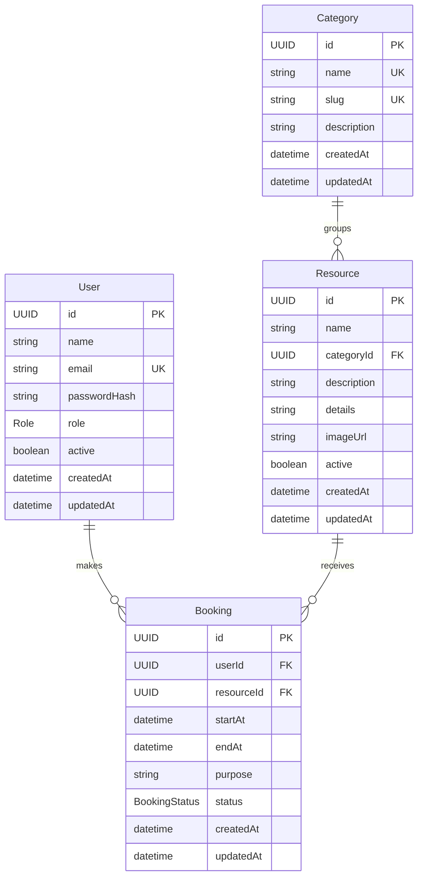

# Resource reservation ER diagram

Paste this Mermaid code into [mermaid.live](https://mermaid.live) to render or share the diagram.

Each category can contain many resources, while every resource belongs to one category. A user can make many bookings, and each booking belongs to one user and one resource.
